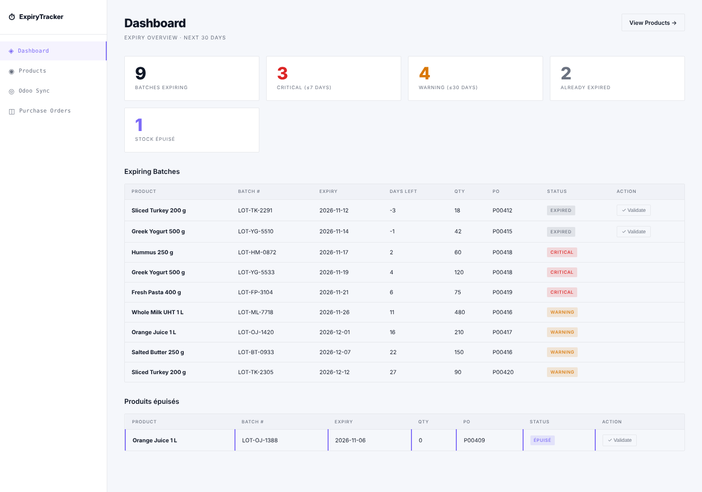
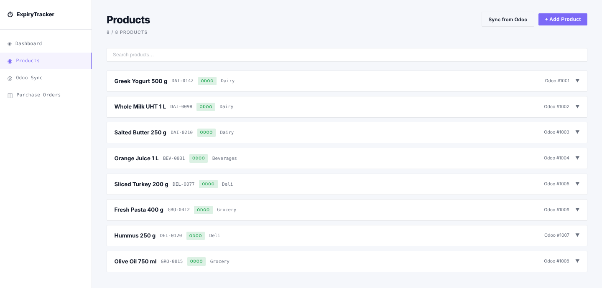
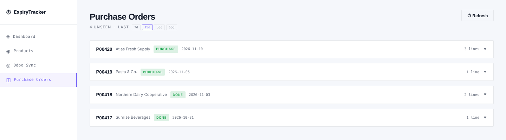

# Odoo Expiry Tracker

Odoo knows how much stock you have. It does not make it easy to see which lots are about to expire. This app connects to an Odoo instance, lets you record batches with their expiry dates against Odoo products and purchase orders, and shows what expires soon.

[](https://github.com/chaffaaanass/odoo-expiry-tracker/actions/workflows/ci.yml)

`Spring Boot 4` · `Java 17` · `Angular 21` · `PostgreSQL` · `Docker` · `GitHub Actions` · `JUnit / Mockito`



| Products | Purchase orders |
|---|---|
|  |  |

Screens captured with sample data.

## What it does

- **Dashboard:** every batch that expires within 30 days, split into expired, critical and warning.
- **Batches per product:** lot number, expiry date, delivery date, quantity, linked purchase order.
- **Purchase orders:** reads confirmed orders from Odoo so batches can be recorded as deliveries arrive.
- **Stock sync:** a scheduled job compares quantities with Odoo and deducts sold stock from the batch that expires first (first expired, first out). Empty batches are marked as depleted.
- **Product sync:** imports the product catalogue from Odoo.

## Architecture

```
browser ──> Nginx ──> Angular app
              │
              └─ /api ──> Spring Boot service ──> PostgreSQL
                               │
                               └── JSON-RPC ──> Odoo
```

| Part | Details |
|---|---|
| `backend/` | Spring Boot 4, Spring Data JPA, Spring Security, Spring Session (JDBC), Quartz and scheduled jobs. A hand-written `OdooClient` talks to Odoo over JSON-RPC and re-authenticates when the Odoo session expires. |
| `frontend/` | Angular 21 with standalone components and signals. Five screens: dashboard, products, batches, Odoo sync, purchase orders. |
| `docker-compose.yml` | Database, back end and front end, started with one command. |

## Run it

You need Docker and access to an Odoo instance (a trial database works).

```bash
cp .env.example .env      # then fill in the Odoo and database values
docker compose up --build
```

Open http://localhost:8080.

The back end logs in to Odoo when it starts, so it will not start without valid Odoo credentials.

### Configuration

| Variable | Purpose |
|---|---|
| `PG_DATABASE`, `PG_USER`, `PG_PASSWORD` | PostgreSQL database |
| `ODOO_BASE_URL`, `ODOO_DATABASE`, `ODOO_USERNAME`, `ODOO_PASSWORD` | Odoo instance and the account the tracker uses |
| `CORS_ALLOWED_ORIGINS` | Origins allowed to call the API, comma-separated |

### Local development

```bash
# back end, on port 8989 (export the variables from .env first)
cd backend && ./mvnw spring-boot:run

# front end, on port 4200, proxies /api to the back end
cd frontend && npm install && npx ng serve --proxy-config proxy.conf.json
```

## API

| Method and path | Purpose |
|---|---|
| `GET /api/products` | List products |
| `POST /api/products/upsert`, `/upsert-bulk` | Create or update products |
| `GET` `POST /api/products/{id}/batches` | List or add batches for a product |
| `PATCH` `DELETE /api/products/{id}/batches/{batchId}` | Edit or remove a batch |
| `GET /api/batches/expiring?days=30` | Batches expiring within the window, including already expired ones |
| `GET /api/batches/depleted` | Batches with no stock left |
| `GET /api/purchase-orders` | Purchase orders read from Odoo |
| `POST /api/odoo/sync-products` | Import the product catalogue from Odoo |
| `GET /health` | Health check |

## Tests

```bash
cd backend && ./mvnw test
```

Unit tests (JUnit 5, Mockito, AssertJ) cover batch rules, product upserts and the Odoo login call. They need no database and no Odoo instance. The pipeline in `.github/workflows/ci.yml` runs them and builds the front end on every push.

## Security note

The API has no user login. The tracker was designed to run inside a private network, with one Odoo service account configured on the server. In production it was served over HTTPS behind Nginx. Put it behind a VPN or an authenticating proxy before exposing it anywhere else.

## Author

Anass Chaffaa — [LinkedIn](https://www.linkedin.com/in/chaffaa-anass-9b538b26b)
